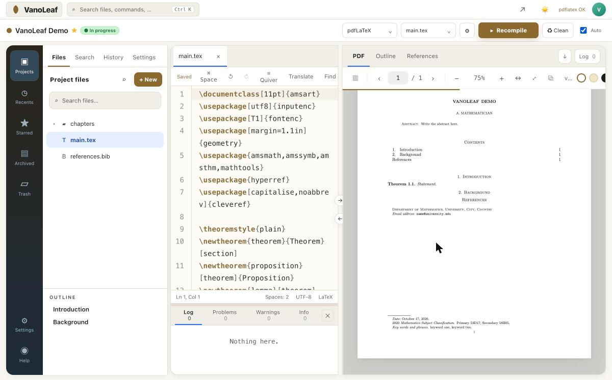

# VanoLeaf — a local LaTeX editor with no compile timeout

  

**VanoLeaf** gives you the Overleaf way of working — file tree, source on the left, PDF on the right, click-to-jump between them — but everything runs **on your own computer**, with your own TeX installation. No account, no upload, no queue, and **no limit on how long a compile may take**.



VanoLeaf is a small Python (Flask) server plus a single-page interface: easy to read, easy to change, and it works offline.

## Why VanoLeaf?

| | Overleaf (free plan) | VanoLeaf |
|---|---|---|
| Compile time limit | Yes — long documents get cut off | **None** — a 300-page thesis compiles to the end |
| Where your files live | On someone else's server | **On your disk**, plain `.tex` files in a folder |
| Internet needed | Always | **Only once** (first launch); then fully offline |
| Speed | Shared servers, queue | **Your own CPU**, fast draft compile while you type |
| Account / subscription | Required | **None** — free and open source (MIT) |
| TeX packages | Fixed server distribution | **Your** MacTeX / MiKTeX / TeX Live, any package you install |
| Privacy | Unpublished research uploaded | **Nothing leaves your computer** |

Good for: theses and long papers, unpublished work you prefer to keep private, working on a plane or with a bad connection, and anyone who wants to keep their LaTeX projects as ordinary folders they can back up, version with git, or sync however they like.

## Features

**Editing**
- Project file tree with folders and every asset (images, `.bib`, `.sty`…); create, upload, rename, move, delete.
- Several source tabs, Quick Open (`Ctrl/Cmd+P`), project-wide search, find & replace, live document outline.
- LaTeX autocomplete: commands, environments, `\cite{}` keys from every `.bib`, `\ref{}` / `\eqref{}` labels, files for `\input` / `\includegraphics`, your own macros.
- Bracket matching, code folding, comment toggle (`Ctrl/Cmd+/`), light / dark themes, eye-comfort mode.
- Local version history per file: automatic snapshots, checkpoints, preview and one-click restore.

**Compiling and the PDF**
- **No timeout.** pdfLaTeX, XeLaTeX, LuaLaTeX or LaTeX, with `latexmk` and automatic BibTeX / Biber when available.
- **Fast draft compile** while you type (a single pass after a short pause), full compile with `Ctrl/Cmd+S` or the Recompile button; Stop and Clean & recompile.
- Error log with All / Errors / Warnings tabs; each entry jumps to the source line. Missing packages come with the install command.
- Sharp PDF preview (PDF.js) that renders pages lazily, so very long documents stay smooth.
- **SyncTeX both ways:** click in the source to find the spot in the PDF, double-click the PDF to jump to the source.

**Projects**
- Dashboard with active, archived and trashed projects; duplicate, rename, export as `.zip`.
- **Import an Overleaf `.zip`** — including projects whose main file is not `main.tex`.
- About 45 templates: AMS article, arXiv preprint, Beamer talks, posters, theses (EN/FR), CVs, letters, referee reports, grant proposals, lecture notes, tikz-cd diagrams…

> VanoLeaf reproduces Overleaf's *editing / compiling / PDF* workflow locally. It does not offer live co-editing, comments or cloud sharing.

## Download

**[⬇ Download VanoLeaf.zip](https://github.com/yassine-aitmohamed/VanoLeaf-LaTeX-Editor/releases/latest/download/VanoLeaf.zip)** — the complete, ready-to-install folder (macOS, Windows and Linux in one zip). Unzip it, then follow the steps for your system below.

## Install

You need **Python 3.9+** and a **TeX distribution**. The first launch downloads the editor libraries once (CodeMirror, PDF.js are also included in `vendor/`), then VanoLeaf works offline and opens at <http://127.0.0.1:5500>.

### macOS

1. Install TeX: `brew install --cask mactex` (full, ~5 GB) — or the smaller BasicTeX:
   ```bash
   brew install --cask basictex
   eval "$(/usr/libexec/path_helper)"
   sudo tlmgr update --self && sudo tlmgr install latexmk biber collection-latexextra collection-mathscience
   ```
2. Download **[VanoLeaf.zip](https://github.com/yassine-aitmohamed/VanoLeaf-LaTeX-Editor/releases/latest/download/VanoLeaf.zip)** and unzip it (or `git clone https://github.com/yassine-aitmohamed/VanoLeaf-LaTeX-Editor.git`).
3. Double-click **`Start VanoLeaf.command`** (or run `./start_vanoleaf.sh`). The first time, macOS may ask you to confirm: right-click → *Open*.
4. Optional: `./install_mac_app.sh` builds a real **VanoLeaf.app** in your Applications folder.

### Windows

1. Download **[VanoLeaf.zip](https://github.com/yassine-aitmohamed/VanoLeaf-LaTeX-Editor/releases/latest/download/VanoLeaf.zip)** and unzip it somewhere with a short path, e.g. `C:\VanoLeaf`.
2. Double-click **`INSTALL.bat`**. It installs Python and **MiKTeX** if they are missing (via `winget`), sets everything up, creates a **VanoLeaf** shortcut on your Desktop and opens the editor.
3. Afterwards, start it from the Desktop shortcut or **`START_VanoLeaf.bat`**. Close its window to stop it.

MiKTeX installs missing LaTeX packages on the fly the first time a document needs them.

### Linux

Install `texlive-full` (or `texlive-latex-extra latexmk biber`) and Python 3, then run `./start_vanoleaf.sh`.

## Where are my files?

Every project is an ordinary folder in `projects/` next to `app.py`. Back it up, put it in Dropbox / iCloud / OneDrive, or track it with git. Your own templates go in `templates/<name>/` (a `main.tex` and a `template.json`).

## Contributing

Issues and pull requests are welcome — bug reports with the compile log are the most useful. The whole app is two files: `app.py` (server, compilation, SyncTeX) and `index.html` (interface).

## En français

VanoLeaf est un éditeur LaTeX **local** dans l'esprit d'Overleaf : arborescence, code à gauche, PDF à droite, SyncTeX dans les deux sens, autocomplétion, historique des versions, import de projets Overleaf. Tout tourne sur votre ordinateur avec votre propre distribution TeX : **pas de limite de temps de compilation**, pas de compte, pas d'envoi de vos travaux non publiés, et il fonctionne hors ligne. Installation : `Start VanoLeaf.command` sur Mac, `INSTALL.bat` sur Windows.

## License

MIT © 2026 Yassine Ait Mohamed. Bundled libraries keep their own licenses: CodeMirror (MIT), PDF.js (Apache 2.0).
